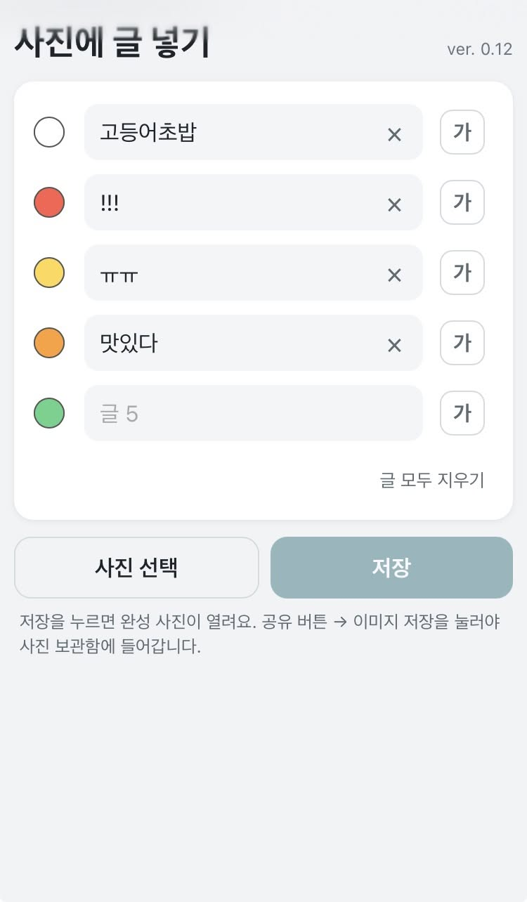
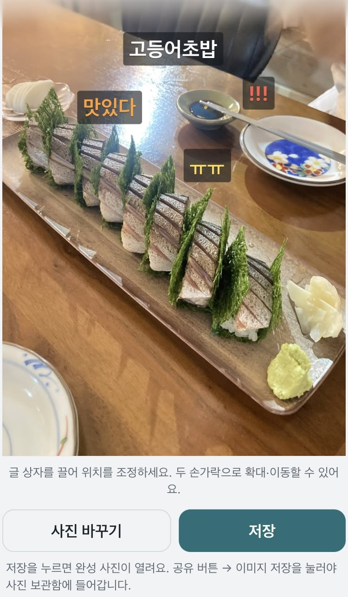

# 사진에 글 넣기

사진 위에 작업 내용이나 전후 설명을 여러 줄로 표시해 저장하는 웹앱입니다. 업무 사진에 메모를 빠르게 넣을 수 있습니다.

**[앱 실행하기](https://unnitti.github.io/photo/)**

  
  

## 사용 환경

- iPhone Safari의 홈 화면에 추가한 웹앱을 기준으로 확인했습니다. Safari 탭, Android 및 다른 브라우저에서의 동작은 별도 확인이 필요합니다.
- 별도 앱 설치나 회원가입이 필요하지 않습니다.

## 사용 방법

### 1. 글 입력

화면 위쪽 입력란에 사진에 넣을 내용을 적습니다. 기본 두 줄로 시작하며, 마지막 줄에 글을 입력하면 다음 줄이 자동으로 추가됩니다. 최대 8줄까지 쓸 수 있고, 비워 둔 줄은 사진에 나타나지 않습니다.

### 2. 글자 크기와 색상 조정

각 줄의 크기 버튼을 눌러 크기를 바꿀 수 있습니다. 크기는 **대 → 소 → 중 → 대** 순으로 반복됩니다.

색상 버튼을 누르면 **흰색 → 빨강 → 노랑 → 파랑 → 초록 → 분홍 → 주황 → 보라** 순으로 바뀝니다. 새로 글을 쓰는 줄에는 아직 사용하지 않은 색이 우선 배정됩니다. 두 줄에서 같은 색을 선택하면 색 표시 안에 겹침 표시가 나타납니다.

### 3. 사진 선택

**사진 선택/바꾸기**를 눌러 사진 보관함에서 사진을 고르거나 새로 촬영합니다. 사진은 원본 해상도로 불러옵니다.

### 4. 글 위치와 사진 조정

사진 위의 글 상자를 손가락으로 끌어 원하는 위치에 놓습니다. 사진은 두 손가락으로 확대·축소하거나 이동할 수 있습니다. 사진을 충분히 축소하면 사진 전체가 화면에 맞게 돌아옵니다.

사진을 바꾸어도 글과 글 상자의 위치는 유지됩니다. 사진의 크기나 비율이 다르면 위치가 비율에 맞춰 조정됩니다.

### 5. 이미지 저장

**저장**을 누르면 완성된 JPEG 이미지가 새 창에서 열립니다. 이 버튼만으로 사진 보관함 저장이 완료되는 것은 아닙니다.

1. 완성 이미지가 열린 화면에서 iPhone의 **공유** 버튼을 누릅니다.
2. **이미지 저장**을 선택합니다.

**파일에 저장**을 선택하면 사진 보관함이 아니라 파일 앱에 저장됩니다. 이미지 창을 닫고 앱으로 돌아오면 입력한 글과 사진이 남아 있어 위치를 조정한 뒤 다시 저장할 수 있습니다.

## 편리한 기능

- **날짜 입력:** 입력란에서 포커스를 옮기면 연속된 6자리 숫자가 `YY.MM.DD`로 바뀝니다. 예: `260923` → `26.09.23`. 문장 안에 있는 6자리 숫자도 변환될 수 있습니다.
- **줄 지우기:** 각 줄의 `×`를 누르면 해당 줄의 글과 크기·색상 설정이 초기화됩니다.
- **글 모두 지우기:** 사진은 유지하고 입력한 글만 지웁니다. 잠시 동안 되돌릴 수 있으며, 되돌리기는 사진에는 적용되지 않습니다.

## 사진과 개인정보

사진과 입력한 글은 외부 서버로 전송되지 않고 브라우저 안에서 처리됩니다. 완성 이미지는 원본 사진을 바탕으로 JPEG로 만들며, 위치와 촬영 정보를 담은 EXIF 정보는 결과에서 제거됩니다.

## 오프라인 사용 및 업데이트

- 처음에는 인터넷에 연결된 상태에서 앱을 열어 주세요. 앱 파일은 브라우저에 캐시되므로, 이후에는 인터넷 연결이 불안정하거나 끊긴 상황에서도 사용할 수 있습니다.
- 앱을 업데이트할 때는 인터넷에 연결한 상태에서 앱을 다시 열어 주세요. 새 버전의 파일을 내려받아 적용합니다.
- 앱 파일을 변경해 배포할 때는 `sw.js`의 캐시 버전도 함께 올려야 합니다. 버전이 바뀌면 새 파일을 캐시에 준비한 뒤 이전 캐시를 교체합니다.
- 브라우저의 웹사이트 데이터나 캐시를 삭제한 경우에는 인터넷에 연결해 앱을 다시 열어야 합니다.

## 문제 해결

- **사진 보관함에 저장되지 않았어요:** 저장 후 열린 이미지 화면에서 **공유 → 이미지 저장**을 선택했는지 확인해 주세요.
- **앱이 예전 버전처럼 보여요:** 인터넷에 연결한 뒤 앱을 다시 열어 주세요. 새 버전의 파일을 내려받아 적용하는 데 잠시 시간이 걸릴 수 있습니다.
- **다른 문제가 생겼어요:** 사용한 iPhone 모델과 iOS 버전, Safari 탭 또는 홈 화면 앱 중 어느 방식으로 실행했는지, 문제가 발생한 단계를 알려주시면 원인을 확인하는 데 도움이 됩니다.

## 유지보수 메모

기능을 수정할 때는 실제 iPhone의 홈 화면 앱에서 글 입력, 사진 조정, 이미지 저장을 확인하고 온라인 및 오프라인 실행도 함께 점검합니다.
